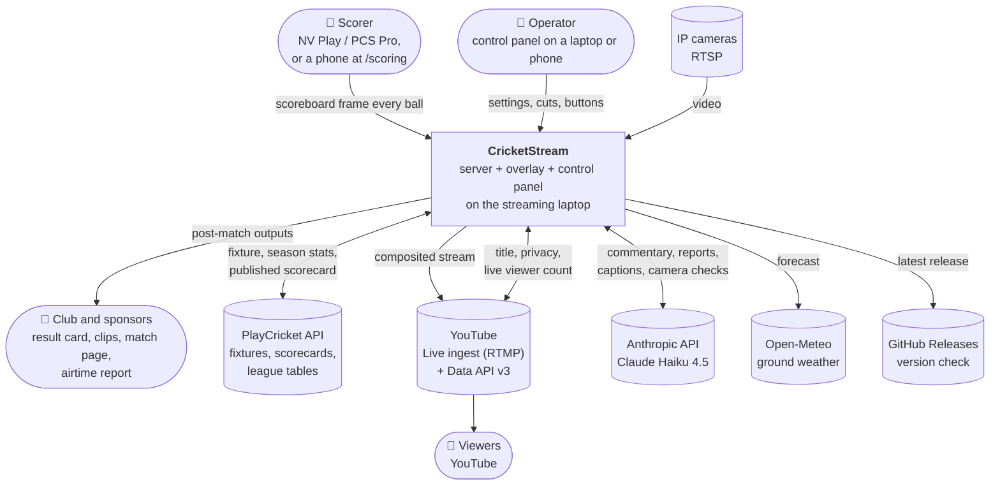
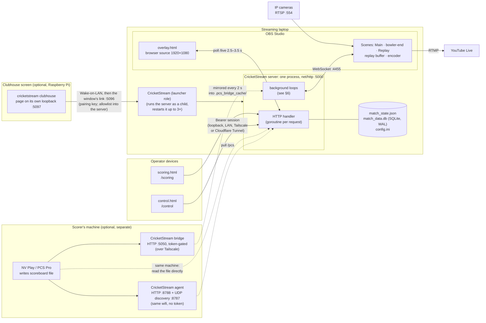
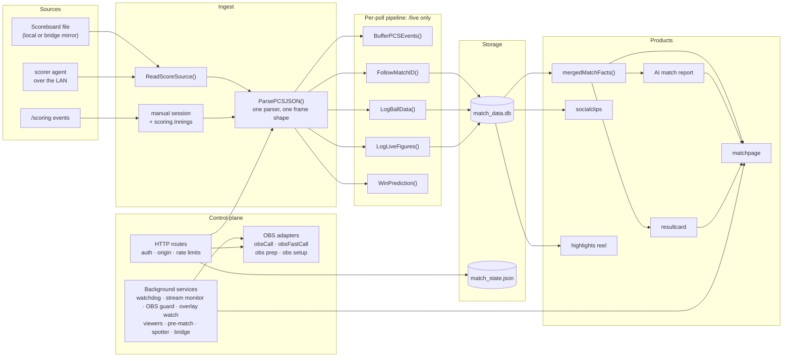
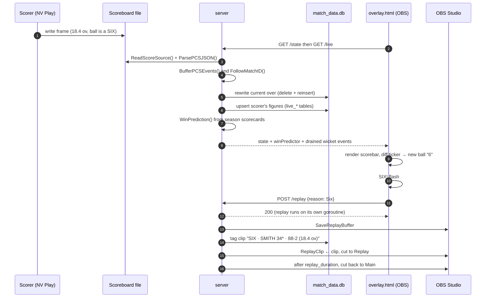
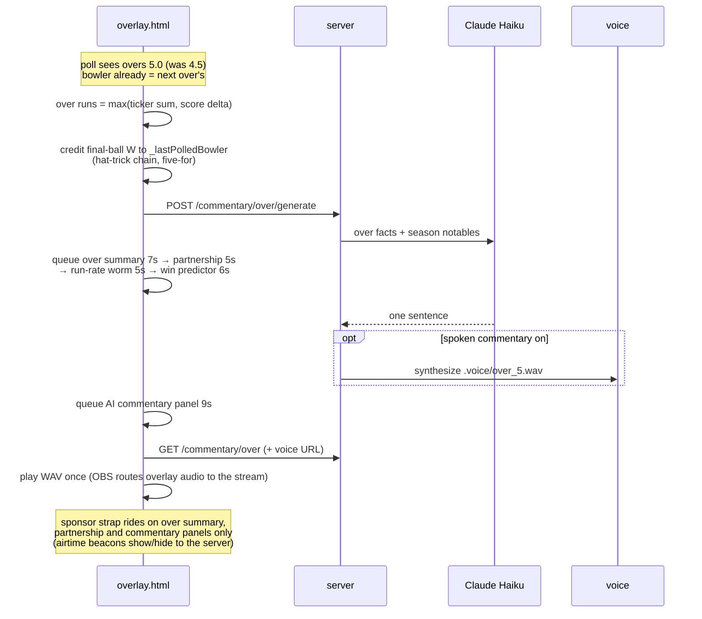
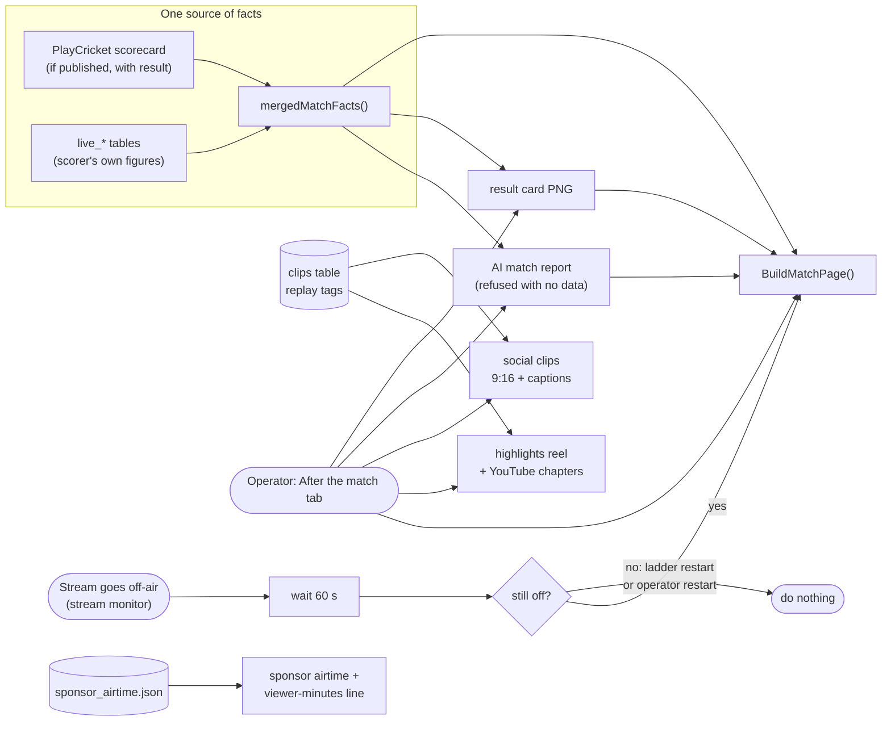
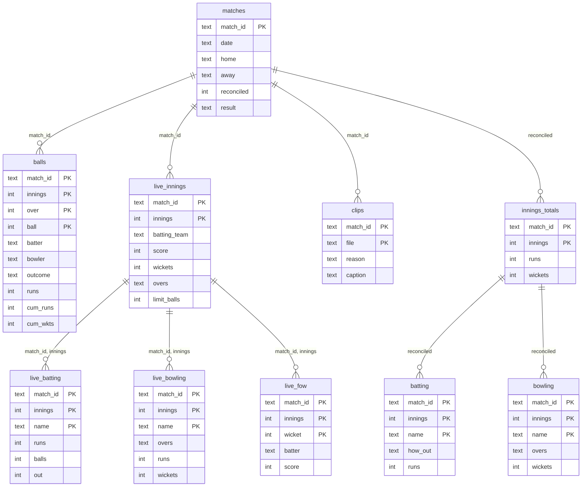
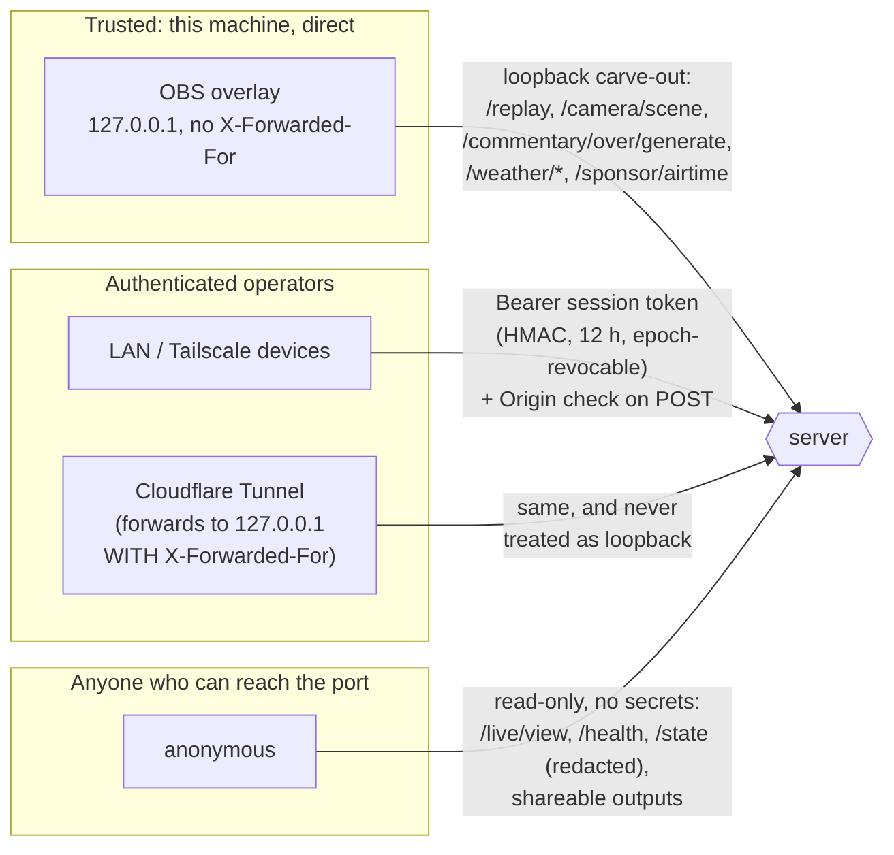

# Architecture

How CricketStream fits together, for contributors and the technically curious. Every
diagram is [Mermaid](https://mermaid.js.org/) and renders on GitHub; edit it as text in
this file. **If you change the architecture, change the picture in the same commit.**

The document follows the usual system-design views, outside in:

1. [Purpose and quality drivers](#1-purpose-and-quality-drivers): what the design is optimised for
2. [System context](#2-system-context): people and external systems
3. [Deployment view](#3-deployment-view): what runs on which machine
4. [Component view](#4-component-view): the one binary, inside the server, and the browser clients
5. [Runtime views](#5-runtime-views): a ball, an over, a replay, the end of the match
6. [Concurrency view](#6-concurrency-view): every background thread and its cadence
7. [Data view](#7-data-view): files, the SQLite schema, what survives a restart
8. [Failure and recovery](#8-failure-and-recovery): what breaks on a match day and what happens next
9. [Security view](#9-security-view): trust boundaries and how each is enforced
10. [Interface catalogue](#10-interface-catalogue): the HTTP surface
11. [Design decisions](#11-design-decisions): the choices, why, and what was rejected
12. [Invariants](#12-invariants): rules that have each been broken once, and must not be again

---

## 1. Purpose and quality drivers

A free broadcast-graphics system for grassroots cricket. The volunteer running it is
not technical, and nobody is at the laptop for most of the match. The scorer's software
writes a file every ball. CricketStream — one Go binary — turns that file into live
graphics inside OBS, and OBS streams to YouTube.

The design in one sentence: **every score source speaks the NV Play "scoreboard frame"
dialect.** The scorer's file, the phone scoring page and the match simulator all produce the
same frame, so every downstream feature works the same whatever the source.

| Driver | What it means here | Where it shows |
|---|---|---|
| **The stream must not stop** | Nothing optional may take the broadcast down | Logging never panics (every background loop recovers); each overlay stage is isolated in its own try/catch; OBS crash and freeze recovery; the launcher restarts a crashed server |
| **Unattended** | Nobody at the laptop to click a dialog | OBS's Safe Mode and update prompts are pre-empted; a detected checklist; a pre-match check that runs itself |
| **Runs on an old laptop that is also encoding video** | CPU headroom belongs to OBS | One native binary, stdlib HTTP server; mtime-cached state; post-match video work at below-normal priority; no encoding mid-match |
| **Correct numbers, never invented ones** | A wrong score on a public result card is worse than none | Facts come from the scorer's own figures or PlayCricket; AI only writes prose around them, and is refused when there's no data |
| **Volunteer-proof** | Setup by double-click; failures explained in words | One file to download, nothing to install; first-run setup is a web page; every fatal path pauses with a plain explanation; a ✓/⚠/✗ pre-match check |
| **Cheap** | Free to run; AI optional, priced in pence | Claude Haiku throughout; every AI feature has a non-AI fallback or is opt-in |

---

## 2. System context

Every external system is optional apart from YouTube. With no internet beyond the
stream, the scorebar, replays, highlights and ball database all still work.

---

## 3. Deployment view

**Why the server can never be a cloud service:** it has to read a file on the scorer's
machine and drive the OBS on the streaming laptop. Remote *operation* is what's exposed
instead: Tailscale (recommended) or an opt-in Cloudflare quick tunnel. Both require a club
password.

**Three ways to reach the scorer's file**, behind one function (`ReadScoreSource()`):

| Mode | When | Transport | Auth |
|---|---|---|---|
| `local` | NV Play on the streaming laptop | file read | n/a |
| `local` + bridge | NV Play elsewhere, different network | `cricketstream bridge` over Tailscale, mirrored to `.pcs_bridge_cache/` | shared token |
| `agent` | Two laptops on the same club wifi | `cricketstream agent`, found by UDP broadcast | none (broadcast domain only) |

A live manual-scoring session (`/scoring`) outranks all three.

---

## 4. Component view

### 4.1 One binary, four roles

Everything is one Go program, `CricketStream`, with every page, font and template built
in (`embed.go`; a file of the same name beside the binary overrides the built-in copy, so
panel edits still show on refresh). With no arguments it opens its own window
(`internal/app`) and does the job `config.ini`'s `role` says there, or asks which
computer this is if there's no `config.ini` yet:

| Role (first screen) | Runs, in the window | Package |
|---|---|---|
| The streaming laptop | the match-day screen; Start runs the launcher (fixture, OBS prep + setup, the server as a supervised child process, pre-flight, telemetry), then the control panel shows in the window; Stop offers the airtime + report | `internal/app` → `internal/launcher` → `internal/server` |
| The scorer's laptop | the scorer agent, with its status (NV Play's file, the streaming laptop collecting it, this laptop's address) | `internal/app` → `internal/agent` |
| NV Play bridge (scorer elsewhere) | the bridge, with its address and token | `internal/app` → `internal/bridge` |
| (no config.ini) | "which computer is this?", the setup page, then that role — no restart | `internal/app` → `internal/setup` |

The window is the system web view (WebView2 on Windows) showing pages the app serves on a
loopback port, each API call carrying a per-run key only its own page has. Where there's
no web view the same pages open in the browser. The control panel stays a web page served
by the server, because phones and tablets use it too; in the window it's logged in with
the launcher's session and gains Activity and Stop buttons.

The optional clubhouse screen isn't a fifth role: it's `cricketstream clubhouse` on a
Raspberry Pi, and a link the streaming laptop's window opens when it's switched on. The
link lives in the window, not the server, because it has to answer before match day starts
(to start it) and after it ends (to switch the laptop off). It drives the same Start, Stop
and questions as the window's own buttons, and reaches the server only on an allowlist of
match-day routes, with the window's login ([`CLUBHOUSE_SCREEN.md`](CLUBHOUSE_SCREEN.md)).

On Windows the window also owns an icon by the clock (`tray_windows.go`, Shell_NotifyIcon
on the window's own message loop) and its notifications. `alerts.go` decides what is
worth one, every 10 seconds: `/health` during match day (feed freshness, the OBS guard's
last event), the agent's own collected-ago on the scorer's laptop, a newer release, and
the launcher's "server stopped unexpectedly" lines from the log. Each condition notifies
once and once more when it clears; an OBS event already there when the app first looks is
the baseline, not news.

Every part is also a subcommand (`server`, `agent`, `bridge`, `simulate`, `obs-setup`,
`telemetry`, …) for automation and troubleshooting.

### 4.2 Inside the server

Data flows left to right: sources, one ingest door, the per-poll pipeline, storage, and
the products built from it. The control plane (HTTP routes, background services, OBS
adapters) sits underneath and drives the rest.

| Package | Responsibility | Pure? |
|---|---|---|
| `internal/server` | HTTP surface, ingest, ball DB (pure-Go SQLite), OBS control, background services, auth | no |
| `internal/scoring` | Deterministic scorer's book: strike rotation, extras, dismissals, figures, frame rendering; the event-sourced session | yes |
| `internal/winpredict` | DLS-shaped resources × this season's scoring, normal-distribution totals; `Backtest()` | yes |
| `internal/resultcard` | Result card PNG from facts + look (built-in fonts) | yes |
| `internal/matchpage` | Self-contained HTML match page; everything HTML-escaped | yes |
| `internal/socialclips` | 1080×1920 ffmpeg filter graph; text only via `textfile=` | yes (+ ffmpeg) |
| `internal/voice` | Text to WAV with the OS voice; text always via a file | yes (+ OS TTS) |
| `internal/logobg` | Transparent background for sponsor logos | yes |
| `internal/obs` | OBS config files while OBS is closed; launch, close, crash marker, freeze ping; scenes, sources, stream key over the WebSocket | no |
| `internal/obsws` | The OBS WebSocket v5 client (per-call and held-open); `obswstest` is a fake OBS for tests | no |
| `internal/app` | The window: first screen, match-day screen, agent/bridge status, the console's questions, activity log | no |
| `internal/launcher` / `internal/setup` | Match-day launch chain; the first-run setup page | no |
| `internal/agent` / `internal/bridge` | The scorer's-laptop roles; no dependency on the server package | no |
| `internal/clubhouse` | The optional clubhouse touch screen: the laptop's link (run by the window), the Pi's `cricketstream clubhouse`, Wake-on-LAN, power-off | no |
| `internal/simulate` | Rehearsal feed: real NV Play quirks, `--chaos` failures | no |
| `internal/tools` | Telemetry, camera encoder read-out, camera refresher, quality-ladder test | no |
| `internal/pyval`, `internal/pyfmt`, `internal/ini`, `internal/htmlesc` | Python-compatible values, number formatting, configparser-compatible INI, `html.escape` — so output stays byte-identical to the original's | yes |

The pure packages are the ones with deep test coverage, several of them differential
tests against the Python original. The server gathers inputs and hands them over, so the
logic can be tested without a server, OBS or a network.

### 4.3 Browser clients

| Client | Served at | Polls | Side effects allowed |
|---|---|---|---|
| `overlay.html` (OBS) | `/overlay` | `/state` + `/live` every 2.5–3.5 s, `/commands` every 3 s | **Yes: the only client of `/live` and `/commands`** |
| `overlay.html?preview=1` | iframe in the panel | one `/state` read, then never again | None |
| `control.html` | `/control` | `/live/view`, `/health` (10 s), checklist, stream monitor (10 s), spotter (60 s)… | Operator POSTs only |
| `scoring.html` | `/scoring` | `/scoring/state` (5 s) | Ball events |
| `clubhouse.html` (the Pi) | the Pi's own loopback, through the window's link | `/live/view`, checklist (3 s), `/preview.jpg` (2 s, only while shown), `/match/scorecard` (10 s, only while shown), `/league/table` | Operator POSTs on the link's allowlist only |

The overlay's graphics are one DOM with a queue (`queueGraphic` → `nextGraphic`). Panels
show one at a time, and every stage is wrapped so one failing graphic can't stall the
queue.

---

## 5. Runtime views

### 5.1 One ball

### 5.2 The end of an over

The over-completing write is the hardest moment in the feed. On that write NV Play has
**already rotated the bowler and swapped the batters' ends**, and it **usually keeps
showing the over as it was before its final ball**. The final delivery is therefore
recovered from the score delta and credited from the previous poll's snapshot.

### 5.3 Post-match products

---

## 6. Concurrency view

One process. `net/http` gives every request its own goroutine, and keeps connections
alive, so a burst of reconnecting pollers costs far less than it did with the original's
connection-per-request server (whose default backlog of 5 refused them at the OS level).
Long-lived work runs on background loops started through `loop()`, each of which recovers
from a panic and carries on:

| Loop | Cadence | Does | If it fails |
|---|---|---|---|
| Watchdog | 90 s | Unsticks the season-stats build, restarts a dead Cloudflare tunnel, trims rate-limit state, logs feed staleness and CPU throttling (Mac and Windows) | Logs, retries next tick |
| Stream monitor | 15 s | OBS stream status, congestion samples, quality-ladder decision, stream-end trigger for the match page | Marks OBS unreachable |
| OBS crash recovery (`obsGuardTick`) | 5 s | OBS crash (sentinel present) → reopen, scene, restart stream if it was live; freeze (window hung 60 s **and** bytes not moving) → kill → reopen | Capped at 3 reopens / 30 min, then a human |
| Overlay watch (`overlayWatchTick`) | 10 s | OBS local and reachable but no overlay `/live` poll for 30 s (its first load beat the server) → reload the Overlay source | 3 reloads between polls, then says to check its URL |
| Viewer sampler | 60 s, live only | YouTube concurrent viewers for sponsor viewer-minutes | Count goes stale (>3 min) and is not used |
| Pre-match check | 30 s after start, then 6 h | All pre-match checks in parallel, 20 s budget | A check that errors is reported ✗, never raised |
| Camera spotter | 60 s tick, check every N min, live only | Camera screenshots → frozen check → Claude Haiku | "Couldn't check", never a false camera problem |
| Bridge mirror (`pcsBridgeTick`) | 2 s, bridge mode only | Mirrors the remote file atomically, keeps its mtime | Holds the last mirror |
| Cloudflare reader | event-driven | Captures the tunnel URL | Watchdog restarts the tunnel |

Short-lived goroutines (`safeGo`, which also recovers): replay (one per trigger), AI over
commentary, match page, social clips, highlights, the checklist's Start OBS job,
season-stats build, league table.

**Shared-state rules.** `SaveState()` is serialised (`stateWriteMu`) and atomic. Any
read-modify-write goes through `UpdateState()` (`stateRMWMu`). The DB is reached through
`dbMu` with WAL. Job flags ("already building") are set under a lock. The overlay-facing
event buffer is drained under `eventBufferMu`, so an event arriving mid-drain is never
lost. CI runs the whole suite under the race detector.

## 7. Data view

### 7.1 Files

| File | Holds | Written by | Survives restart | Git |
|---|---|---|---|---|
| `config.ini` | Club identity, keys, OBS/stream policy, auth, this machine's role | setup page, OBS prep | yes | ignored |
| `match_state.json` | Everything the panel edits | `SaveState` (atomic, mtime-cached reads) | yes | ignored |
| `match_data.db` | Ball log, live figures, replay tags, reconciled scorecards | loggers | yes | ignored |
| `manual_scoring.json` | `/scoring` event log | every action | yes, replayed on load | ignored |
| `season_stats_cache.json` | Season batting lookup + `innings_history` for the win model | daily build | yes (same day) | ignored |
| `sponsor_airtime.json` | Per-day on-air seconds, shows, viewer-minutes | airtime beacon | yes | ignored |
| `match_pages/`, `.voice/`, replay folder | Post-match outputs, spoken lines (last 20), clips | jobs | yes | ignored |
| `diagnostics/telemetry_*.csv` | Match-day bandwidth, drops, congestion, match context | `cricketstream telemetry` (started by the launcher) | yes | ignored |
| `bridge_config.ini`, `scorer_agent.json` | The bridge's folder/port/token; the agent's remembered folder | those roles | yes | ignored |

All of these live beside the binary (or under `CRICKETSTREAM_HOME`), never in a system
folder: one folder is the whole install and the whole backup.

### 7.2 Database schema

Three layers, in increasing order of authority:

1. **`balls`** is a reconstruction from the ticker. It is good for the worm and
   ball-by-ball CSV, but its `batter` column is whoever was batter1 at the over's last
   write.
2. **`live_*`** holds the scorer's own running figures, upserted every frame. These are
   exact, and they are what reports, result cards and the match page read.
3. **`innings_totals` / `batting` / `bowling`** hold PlayCricket's published scorecard,
   written by Reconcile. They are the record of truth after the match.

`match_id` is the PlayCricket id once known, else `date_home_v_away`. Every table keyed
by it is listed in `matchTables`, so `FollowMatchID()` can move a match's rows when the
id changes mid-innings.

---

## 8. Failure and recovery

| Failure | Detected by | Automatic response | Operator sees |
|---|---|---|---|
| Scorer's file mid-write or corrupt | parse fails | Hold the last good frame | Nothing |
| Scorer feed stops | watchdog, `/health` | Overlay keeps the last score | "feed stale" in the health strip |
| Scorer's laptop (agent) unreachable | `ReadAgentFile` | Last score for 120 s, then rediscover every 15 s | Agent status + checklist button |
| OBS crashes | OBS guard: port down + crash sentinel | Clear sentinel, reopen past Safe Mode, Main scene, restart stream **only if it was live** | Event in `/health` → `obs_recovery` |
| Overlay never loaded (OBS opened before the server) | overlay watch: no `/live` for 30 s | Reload the Overlay source (`refreshnocache`), up to 3 times | `/health` → `overlay`; watchdog log |
| OBS freezes | Window hung 60 s **and** stream bytes not moving | Force-close → treated as a crash | Same |
| OBS frozen but still streaming | Bytes moving | **Left alone** (killing it would cause the outage) | Warning |
| Upload congested | Stream monitor: 60 s congestion/drops | OBS dynamic bitrate; optional quality ladder down (never up on its own) | Monitor card, step history |
| Server crashes | launcher | Relaunch up to 3× with backoff | Console |
| State file unreadable | `LoadState` | Last good copy, else defaults | Console warning |
| YouTube login expired | refresh error | Say so; never open a login mid-match | Pre-match check ✗ |
| Anthropic unavailable | API error | Commentary skipped; captions fall back to templates | Nothing on air |
| Camera fogged or knocked | Camera spotter (opt-in) | None (can't wipe a lens) | Red camera badge in the pinned bar |
| Leftover quality downshift | Pre-match check, `/health` | The launcher resets the bitrate on next start | ⚠/✗ before going live |

The rule behind the table: **automate what is safe to repeat, never what could put the
club on air by surprise.** The stream is only restarted when OBS itself said it was live
just before the crash. A normal close is never undone. A congested stream is never
stepped *up* automatically.

---

## 9. Security view

- **Auth is off on a localhost-only install and required beyond it.** Binding to anything
  but 127.0.0.1 without a club password falls back to 127.0.0.1.
- **Sessions:** the password is exchanged for `expiry:nonce:HMAC(control_token+epoch)`.
  Tokens are Bearer only, never cookies, so a cross-site page has nothing to ride on.
  "Log everyone out" rotates the epoch. Five failures in 10 minutes lock that client out.
- **Secrets never reach a browser.** `/state` replaces each key in `SecretKeys` with a
  sentinel, and a POST carrying the sentinel leaves the stored value alone.
- **Inputs are distrusted:** uploads are typed by magic bytes (never SVG). Paths are
  reduced to a basename. AI text and player names are escaped in every HTML sink. Text
  reaches ffmpeg and the speech engine only via files, never argv or a filter string.
- **Shareable outputs are open by design:** result card, social clips, match page, sponsor
  airtime. They contain nothing that isn't already meant for the public.

---

## 10. Interface catalogue

| Group | Endpoints | Access |
|---|---|---|
| Pages | `/overlay`, `/control`, `/scoring` | open (the panel asks for a login when a password is set) |
| Live feed | `/live` *(overlay only, mutating)*, `/live/view`, `/state` GET, `/commands` *(pops)* | open, secrets redacted |
| Settings | `/state` POST, `/login`, `/auth/logout_all`, `/auth/log` | token |
| Overlay actions | `/replay`, `/camera/scene`, `/commentary/over/generate`, `/weather/show`, `/weather/hide`, `/sponsor/airtime` POST | loopback or token |
| Match day | `/checklist`, `/checklist/action`, `/match/fetch`, `/obs/add_camera`, `/stream/quality`, `/stream/dynamic`, `/youtube/update`, `/camera/spotter`, `/precheck`, `/precheck/last` | token |
| Manual scoring | `/scoring/setup`, `/scoring/{ball,undo,edit,bowler,batter,strike,innings,reset}`, `/scoring/state`, `/scoring/balls`, `/scoring/scorecard` | token for writes |
| Stats and context | `/player/stats`, `/season/top`, `/league/table`, `/weather`, `/headshot/*`, `/logo/*`, `/sponsor/*` | open |
| After the match | `/report/generate`, `/social/image/generate`, `/social/recent`, `/social/clips`, `/match/page`, `/highlights`, `/data/export`, `/data/reconcile` | token |
| Shareable outputs | `/social/image/latest`, `/social/clips/file/*`, `/match/page/latest`, `/sponsor/airtime` GET | open |
| Diagnostics | `/health`, `/status`, `/stream/monitor`, `/pcs/debug`, `/logos/debug`, `/data/status`, `/agent/status`, `/remote/info` | open |

Routing rule: exact paths are matched before prefixes (`/sponsor/airtime` before
`/sponsor/<id>`).

---

## 11. Design decisions

| # | Decision | Why | Rejected alternative |
|---|---|---|---|
| D1 | One frame dialect for every source | Every feature written once and tested against one shape | Per-source adapters downstream |
| D2 | `/live` mutates; everything else reads `/live/view` | The pipeline needs exactly one clock: the overlay's poll | A server-side poll loop (a second clock to keep in step) |
| D3 | Stdlib `net/http`, connection-per-call OBS | Nothing to install; nothing long-lived to wedge after an OBS restart | A web framework; one persistent OBS socket for everything |
| D4 | Held-open OBS socket for camera cuts only | Cuts 3.6× quicker; reconnect-on-error keeps it safe | Using it for everything |
| D5 | OBS settings edited as files while OBS is closed | OBS has no API for them, and overwrites them on exit if open | Driving the settings UI; editing while running |
| D6 | Event-sourced manual scoring over a deterministic engine | Exact undo and edit; restart resumes mid-over | Mutable scorecard with patch-up undo |
| D7 | Scorer's figures (`live_*`) for every published fact; AI writes prose only | A made-up score on a public card is the worst failure | Asking the model for the result |
| D8 | Win model from the league's own season, backtested | Honest for the level of cricket being played | Professional-cricket priors |
| D9 | Post-match video work after the stream, below-normal priority | x264 on the same laptop competes with OBS's encoder | Rendering clips as replays happen |
| D10 | Opt-in for anything that costs money or speaks on air | Volunteers must never be surprised by a bill or a voice | On by default |
| D11 | Server stays on the club laptop; remote access via Tailscale/Cloudflare | It must read the scorer's file and drive the local OBS | A cloud relay (scoped, not built) |
| D12 | One Go binary for every role, assets built in, data beside it | A volunteer downloads one file per machine and never installs a runtime; nothing can be half-installed | Python + installer + per-role executables (the original: three launchers, a wizard that installed Python, and a separate scorer-agent exe) |
| D13 | First-run setup as a web page served by the binary | Works the same on Windows and macOS, shows a live scorebar preview, and needs no GUI toolkit | A console interview (the original); a native GUI per platform |
| D14 | Port, not rewrite: behaviour, output bytes and tests carried over | Clubs' overlays, panels and saved files keep working unchanged; differential tests prove it | Redesigning while porting |

---

## 12. Invariants

Each of these was broken once and fixed. [`CLAUDE.md`](CLAUDE.md) has the full story for each.

1. Only the OBS overlay calls `/live` and `/commands`. Preview mode makes one `/state`
   read and nothing else.
2. Every score-feed consumer goes through `ReadScoreSource()` / `EffectivePCSFolder()`,
   and honours a live manual session first.
3. Nothing in the match-day loop may panic or fail the request. Logging swallows its errors; background loops recover; overlay stages are isolated.
4. State writes are atomic and serialised. Read-modify-write goes through `UpdateState()`.
5. On the over-completing write, the bowler and ends have already rotated. Credit the final
   ball from the previous poll's snapshot. Match each ticker to the over it belongs to.
6. A new `match_id`-keyed table must be added to `matchTables`.
7. Endpoints the overlay calls need the loopback carve-out. Endpoints that start OBS or go
   live must never get it.
8. No club identity in defaults. No secrets in git (globbed ignores).
9. Never test against the real OBS install. Use a portable copy only.
10. `overlay.html` is a fixed 1920×1080 canvas with a 72 px scorebar. Panels align to it.
