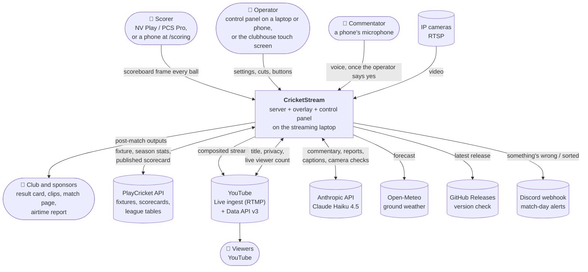
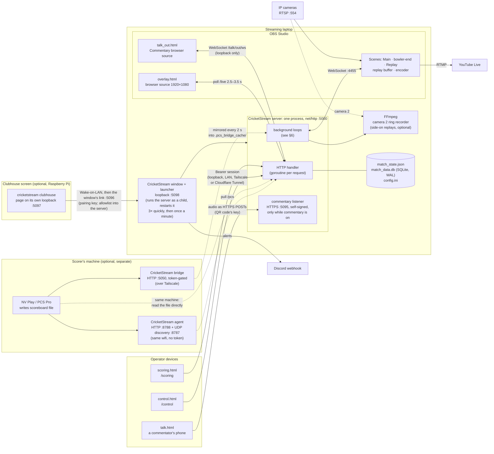
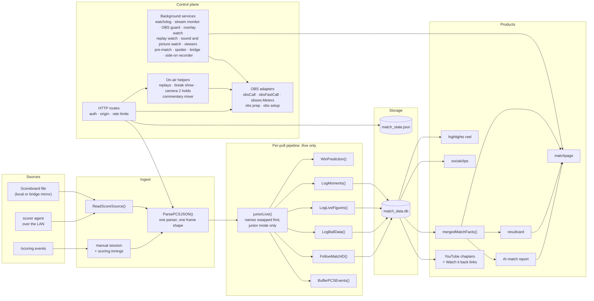
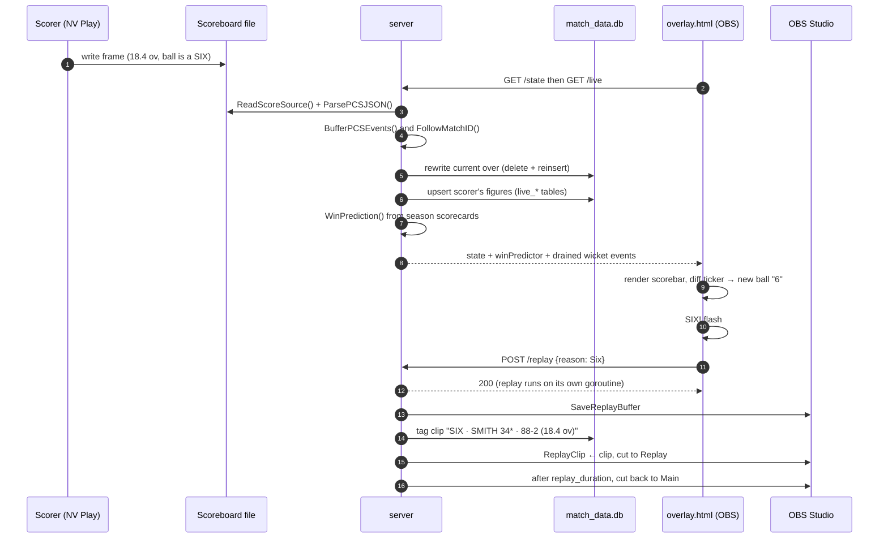
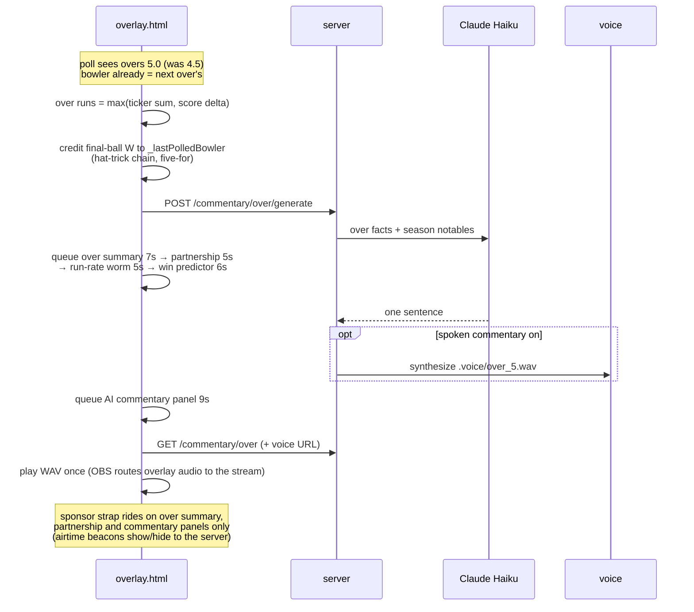
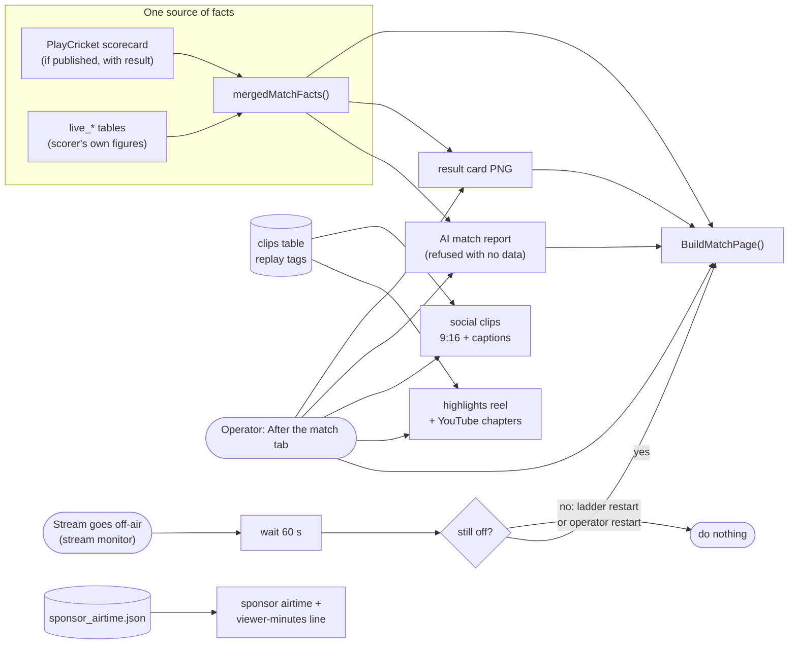
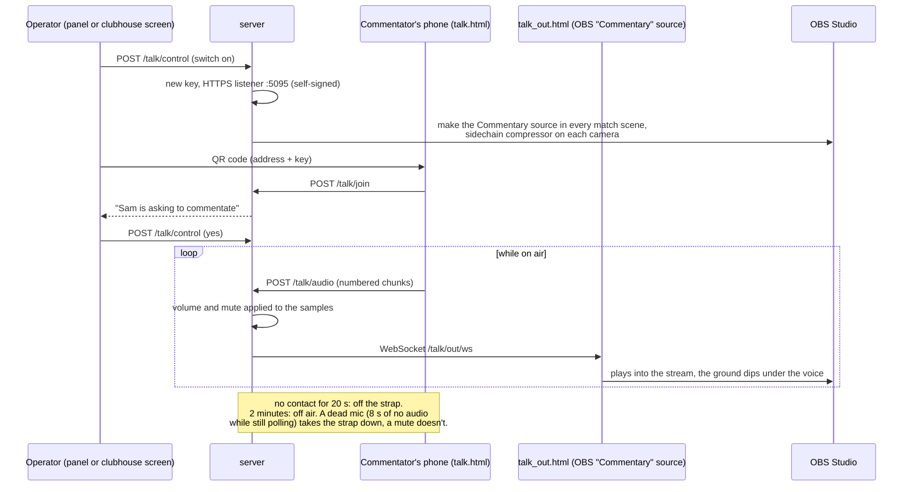
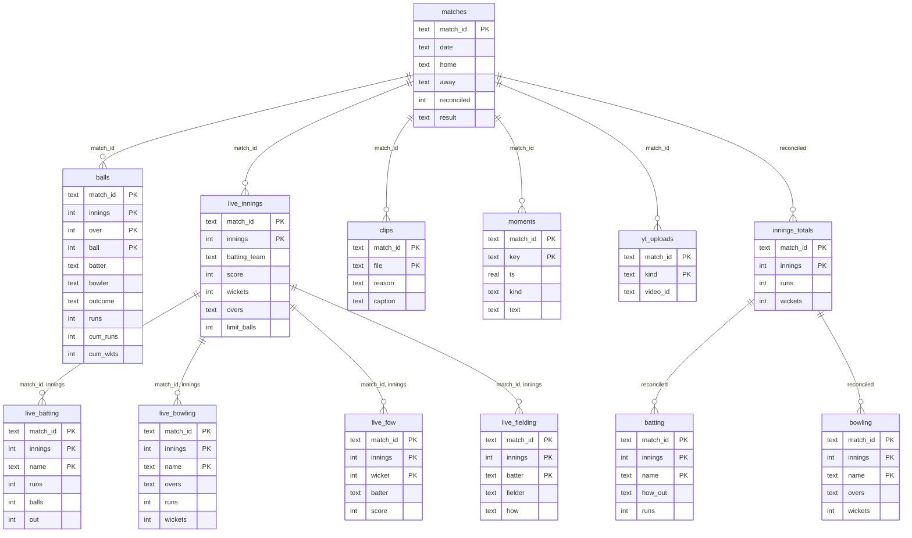
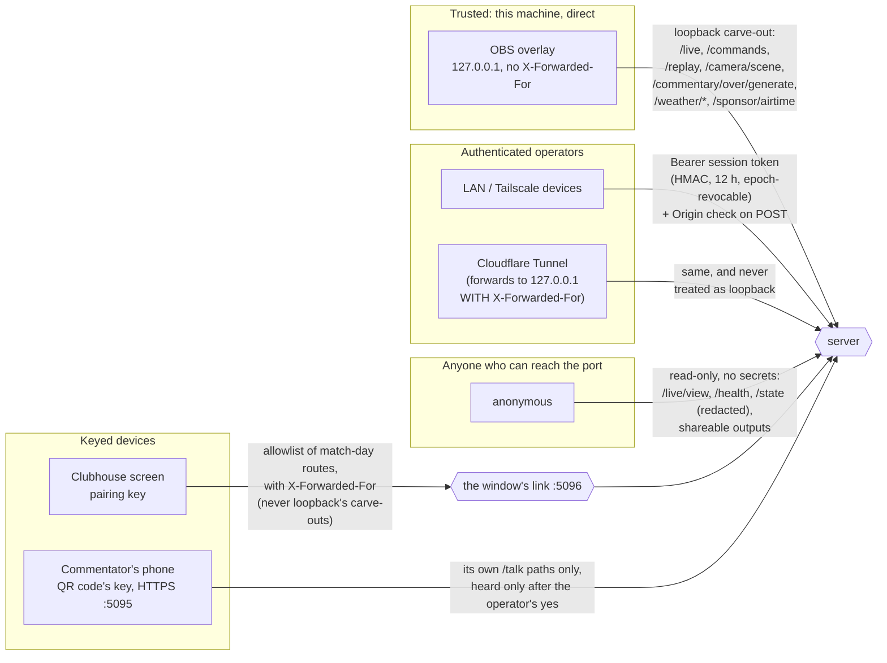

# Architecture

How CricketStream fits together, for contributors and the technically curious. Every
diagram is [Mermaid](https://mermaid.js.org/) and renders on GitHub; edit it as text in
this file. **If you change the architecture, change the picture in the same commit.**

The document follows the usual system-design views, outside in:

1. [Purpose and quality drivers](#1-purpose-and-quality-drivers): what the design is optimised for
2. [System context](#2-system-context): people and external systems
3. [Deployment view](#3-deployment-view): what runs on which machine
4. [Component view](#4-component-view): the one binary, inside the server, and the browser clients
5. [Runtime views](#5-runtime-views): a ball, an over, the end of the match, a voice from a phone
6. [Concurrency view](#6-concurrency-view): every background thread and its cadence
7. [Data view](#7-data-view): files, the SQLite schema, what survives a restart
8. [Failure and recovery](#8-failure-and-recovery): what breaks on a match day and what happens next
9. [Security view](#9-security-view): trust boundaries and how each is enforced
10. [Interface catalogue](#10-interface-catalogue): the HTTP surface
11. [Design decisions](#11-design-decisions): the choices, why, and what was rejected
12. [Invariants](#12-invariants): rules that have each been broken once, and must not be again

---

## 1. Purpose and quality drivers

A free broadcast-graphics system for grassroots cricket. The volunteer running it is
not technical, and nobody is at the laptop for most of the match. The scorer's software
writes a file every ball. CricketStream — one Go binary — turns that file into live
graphics inside OBS, and OBS streams to YouTube.

The design in one sentence: **every score source speaks the NV Play "scoreboard frame"
dialect.** The scorer's file, the phone scoring page and the match simulator all produce the
same frame, so every downstream feature works the same whatever the source.

| Driver | What it means here | Where it shows |
|---|---|---|
| **The stream must not stop** | Nothing optional may take the broadcast down | Logging never panics (every background loop recovers); each overlay stage is isolated in its own try/catch; OBS crash and freeze recovery; the launcher restarts a crashed or stuck server and never gives up; watchers for a missed overlay load, a replay that never cut back, silence and a frozen picture |
| **Unattended** | Nobody at the laptop to click a dialog | OBS's Safe Mode and update prompts are pre-empted; a detected checklist; a pre-match check that runs itself; alerts to the club's Discord channel; an optional scheduled start and clubhouse touch screen |
| **Runs on an old laptop that is also encoding video** | CPU headroom belongs to OBS | One native binary, stdlib HTTP server; mtime-cached state; post-match video work at below-normal priority; no encoding mid-match |
| **Correct numbers, never invented ones** | A wrong score on a public result card is worse than none | Facts come from the scorer's own figures or PlayCricket; AI only writes prose around them, and is refused when there's no data |
| **Volunteer-proof** | Setup by double-click; failures explained in words | One file to download, nothing to install; first-run setup is a web page; every fatal path pauses with a plain explanation; a ✓/⚠/✗ pre-match check |
| **Cheap** | Free to run; AI optional, priced in pence | Claude Haiku throughout; every AI feature has a non-AI fallback or is opt-in |

---

## 2. System context

Every external system is optional apart from YouTube. With no internet beyond the
stream, the scorebar, replays, highlights and ball database all still work. Commentary
from a phone needs only the club's own wifi.

---

## 3. Deployment view

**Why the server can never be a cloud service:** it has to read a file on the scorer's
machine and drive the OBS on the streaming laptop. Remote *operation* is what's exposed
instead: Tailscale (recommended) or an opt-in Cloudflare quick tunnel. Both require a club
password.

**Ports.** 5000 the server (`CRICKETSTREAM_PORT`); 5098 the window's own pages, loopback
only; 5096 the clubhouse screen's link, only while it's switched on; 5095 the commentary
phone's HTTPS, only while commentary is on; 4455 OBS's WebSocket. On the Pi, 5097 is its
own page, loopback only.

**Three ways to reach the scorer's file**, behind one function (`ReadScoreSource()`):

| Mode | When | Transport | Auth |
|---|---|---|---|
| `local` | NV Play on the streaming laptop | file read | n/a |
| `local` + bridge | NV Play elsewhere, different network | `cricketstream bridge` over Tailscale, mirrored to `.pcs_bridge_cache/` | shared token |
| `agent` | Two laptops on the same club wifi | `cricketstream agent`, found by UDP broadcast | none (broadcast domain only) |

A live manual-scoring session (`/scoring`) outranks all three.

---

## 4. Component view

### 4.1 One binary, four roles

Everything is one Go program, `CricketStream`, with every page, font and template built
in (`embed.go`; a file of the same name beside the binary overrides the built-in copy, so
panel edits still show on refresh). With no arguments it opens its own window
(`internal/app`) and does the job `config.ini`'s `role` says there, or asks which
computer this is if there's no `config.ini` yet:

| Role (first screen) | Runs, in the window | Package |
|---|---|---|
| The streaming laptop | the match-day screen; Start runs the launcher (fixture, OBS prep + setup, the server as a supervised child process, pre-flight, telemetry), then the control panel shows in the window; Stop offers the airtime + report | `internal/app` → `internal/launcher` → `internal/server` |
| The scorer's laptop | the scorer agent, with its status (NV Play's file, the streaming laptop collecting it, this laptop's address) | `internal/app` → `internal/agent` |
| NV Play bridge (scorer elsewhere) | the bridge, with its address and token | `internal/app` → `internal/bridge` |
| (no config.ini) | "which computer is this?", the setup page, then that role — no restart | `internal/app` → `internal/setup` |

The window is the system web view (WebView2 on Windows) showing pages the app serves on a
loopback port, each API call carrying a per-run key only its own page has. Where there's
no web view the same pages open in the browser. The control panel stays a web page served
by the server, because phones and tablets use it too; in the window it's logged in with
the launcher's session and gains Activity and Stop buttons.

The optional clubhouse screen isn't a fifth role: it's `cricketstream clubhouse` on a
Raspberry Pi, and a link the streaming laptop's window opens when it's switched on. The
link lives in the window, not the server, because it has to answer before match day starts
(to start it) and after it ends (to switch the laptop off). It drives the same Start, Stop
and questions as the window's own buttons, and reaches the server only on an allowlist of
match-day routes, with the window's login ([`CLUBHOUSE_SCREEN.md`](CLUBHOUSE_SCREEN.md)).

On Windows the window also owns an icon by the clock (`tray_windows.go`, Shell_NotifyIcon
on the window's own message loop) and its notifications. `alerts.go` decides what is
worth one, every 10 seconds: `/health` during match day (feed freshness, the OBS guard's
last event), the agent's own collected-ago on the scorer's laptop, a newer release, and
the launcher's "server stopped unexpectedly" lines from the log. Each condition notifies
once and once more when it clears; an OBS event already there when the app first looks is
the baseline, not news. The same notices go to the club's Discord channel when `[Alerts]
discord_webhook` is set (`internal/discord`; the webhook is read from `config.ini` at each
alert and never enters the state).

With `[App] auto_start` on, the window also starts match day by itself so many minutes
before today's fixture on PlayCricket (`autostart.go`, a look every 30 s): OBS opens and the
pre-match show goes up. It never goes live, and it does nothing on a day when anyone has
already started or stopped match day.

Every part is also a subcommand (`server`, `agent`, `bridge`, `simulate`, `obs-setup`,
`telemetry`, …) for automation and troubleshooting.

### 4.2 Inside the server

Data flows left to right: sources, one ingest door, the per-poll pipeline, storage, and
the products built from it. The control plane (HTTP routes, background services, OBS
adapters) sits underneath and drives the rest.

| Package | Responsibility | Pure? |
|---|---|---|
| `internal/server` | HTTP surface, ingest, ball DB (pure-Go SQLite), OBS control, background services, auth | no |
| `internal/scoring` | Deterministic scorer's book: strike rotation, extras, dismissals, figures, frame rendering; the event-sourced session | yes |
| `internal/winpredict` | DLS-shaped resources × this season's scoring, played ball by ball from the current state over a range of possible days; `Backtest()` | yes |
| `internal/resultcard` | Result card PNG from facts + look (built-in fonts) | yes |
| `internal/matchpage` | Self-contained HTML match page; everything HTML-escaped | yes |
| `internal/socialclips` | 1080×1920 ffmpeg filter graph; text only via `textfile=` | yes (+ ffmpeg) |
| `internal/voice` | Text to WAV with the OS voice; text always via a file | yes (+ OS TTS) |
| `internal/logobg` | Transparent background for sponsor logos | yes |
| `internal/obs` | OBS config files while OBS is closed; launch, close, crash marker, freeze ping; scenes, sources, stream key over the WebSocket | no |
| `internal/obsws` | The OBS WebSocket v5 client (per-call, held-open, and `Meters`: its own connection for sound levels); `Guard` refuses a sandbox any OBS but its own; `obswstest` is a fake OBS for tests | no |
| `internal/onvif` | Finding IP cameras on the network for the panel's camera search | no |
| `internal/app` | The window: first screen, match-day screen, agent/bridge status, the console's questions, activity log, notifications, the scheduled start | no |
| `internal/launcher` / `internal/setup` | Match-day launch chain and the server's supervisor; the first-run setup page and `config.ini` writing | no |
| `internal/agent` / `internal/bridge` / `internal/scorerfile` | The scorer's-laptop roles; finding NV Play's output. No dependency on the server package | no |
| `internal/discord` | Posting an alert to the club's webhook; strips the webhook from every error | no |
| `internal/passhash` | The club password's PBKDF2 hash and check; the local login the laptop's own tools use | yes |
| `internal/clubpack` | "Move to another laptop": the club's settings and pictures as one file, without this machine's keys | no |
| `internal/ai` | The one door to the Anthropic API | no |
| `internal/console`, `internal/proc`, `internal/assets`, `internal/port`, `internal/browser` | Prompts and fatal paths that pause (questions in the window); child processes tied to their parent; built-in files with a beside-the-binary override; the server port; opening a page | no |
| `internal/clubhouse` | The optional clubhouse touch screen: the laptop's link (run by the window), the Pi's `cricketstream clubhouse`, Wake-on-LAN, power-off | no |
| `internal/simulate` | Rehearsal feed: real NV Play quirks, `--chaos` failures | no |
| `internal/tools` | Telemetry, camera encoder read-out, camera refresher, quality-ladder test | no |
| `internal/pyval`, `internal/pyfmt`, `internal/ini`, `internal/htmlesc` | Python-compatible values, number formatting, configparser-compatible INI, `html.escape` — so output stays byte-identical to the original's | yes |

The pure packages are the ones with deep test coverage, several of them differential
tests against the Python original. The server gathers inputs and hands them over, so the
logic can be tested without a server, OBS or a network.

### 4.3 Browser clients

| Client | Served at | Polls | Side effects allowed |
|---|---|---|---|
| `overlay.html` (OBS) | `/overlay` | `/state` + `/live` every 2.5–3.5 s, `/commands` every 3 s | **Yes: the only client of `/live` and `/commands`** |
| `talk_out.html` (OBS, the `Commentary` source) | `/talk/out`, loopback only | a WebSocket, `/talk/out/ws` | Plays the commentators' voices into the stream |
| `talk.html` (a commentator's phone) | `/talk` on the HTTPS port (or the tunnel) | `/talk/poll`; audio up as POSTs to `/talk/audio` | Its own voice only, and only once the operator says yes |
| `app.html`, `setup.html` (the window) | loopback :5098 | the app's own `/api/` with a per-run key | Start/stop match day, setup, answers to the console's questions |
| `overlay.html?preview=1` | iframe in the panel | one `/state` read, then never again | None |
| `control.html` | `/control` | `/live/view`, `/health` (10 s), checklist, stream monitor (10 s), spotter (60 s)… | Operator POSTs only |
| `scoring.html` | `/scoring` | `/scoring/state` (5 s) | Ball events |
| `clubhouse.html` (the Pi) | the Pi's own loopback, through the window's link | `/live/view`, checklist (3 s), `/preview.jpg` (2 s, only while shown), `/match/scorecard` (10 s, only while shown), `/league/table`; the Stats tab reads the Pi's own copy of `/club/stats` (refreshed weekly) | Operator POSTs on the link's allowlist only |

The overlay's graphics are one DOM with a queue (`queueGraphic` → `nextGraphic`). Panels
show one at a time, and every stage is wrapped so one failing graphic can't stall the
queue.

Every frame from `/live` is drawn in one place, `applyLiveFrame`; `poll()` only fetches and
queues. That's what lets the optional graphics delay (`graphics_delay`, to match a camera's
lag) hold whole frames, in order. `/commands`, the operator's buttons, is never held.

---

## 5. Runtime views

### 5.1 One ball

The cut back is one request, so `replaywatch.go` watches for it failing: the Replay scene
on air with no replay meant to be there (`noteReplay`) is cut away from. A boundary's
replay waits for its animation (`hold_ms`): the clip is saved at the same moment, the cut
is held.

### 5.2 The end of an over

The over-completing write is the hardest moment in the feed. On that write NV Play has
**already rotated the bowler and swapped the batters' ends**, and it **usually keeps
showing the over as it was before its final ball**. The final delivery is therefore
recovered from the score delta and credited from the previous poll's snapshot.

### 5.3 Post-match products

Moments (innings, wickets, fifties, hundreds, five-fors) are written to the `moments`
table as they happen. Ninety seconds after the stream ends they become the YouTube video's
chapters, and the match page's **Watch it back** links.

### 5.4 Commentary from a phone

Audio goes up as POSTs, not a WebSocket, because a phone's browser may refuse `wss://` to a
self-signed certificate. The HTTPS port serves the phone's handful of paths and nothing
else.

---

## 6. Concurrency view

One process. `net/http` gives every request its own goroutine, and keeps connections
alive, so a burst of reconnecting pollers costs far less than it did with the original's
connection-per-request server (whose default backlog of 5 refused them at the OS level).
Long-lived work runs on background loops started through `loop()`, each of which recovers
from a panic and carries on:

| Loop | Cadence | Does | If it fails |
|---|---|---|---|
| Watchdog | 90 s | Unsticks the season-stats build, restarts a dead Cloudflare tunnel, trims rate-limit state, logs feed staleness and CPU throttling (Mac and Windows) | Logs, retries next tick |
| Stream monitor | 15 s | OBS stream status, congestion samples, quality-ladder decision, stream-end trigger for the match page | Marks OBS unreachable |
| OBS crash recovery (`obsGuardTick`) | 5 s | OBS crash (sentinel present) → reopen, scene, restart stream if it was live; freeze (window hung 60 s **and** bytes not moving) → kill → reopen | Capped at 3 reopens / 30 min, then a human |
| Overlay watch (`overlayWatchTick`) | 10 s | OBS local and reachable but no overlay `/live` poll for 30 s (its first load beat the server) → reload the Overlay source | 3 reloads between polls, then says to check its URL |
| Replay watch (`replayWatchTick`) | 10 s | The Replay scene on air, two checks running, with no replay meant to be on → cut back to Main | Tries again next tick |
| Sound and picture watch (`avWatchTick`) | 15 s, on air only | Sound levels from `obsws.Meters`, a look at each camera: silence for 45 s (after sound's been heard that day), or a picture that's stopped changing (after it's been seen moving) | Reports only: `/health` → `av`, a notification, Discord |
| Commentary (`talkTick`) | 2 s | Drops phones that have gone, keeps `talk_session.json` fresh, re-checks the `Commentary` source every 15 s while on | A phone comes off the strap, then off air |
| Side-on recorder (`sideCamLoop`) | continuous while `replay_side_on` is on | FFmpeg copies camera 2 into a ring of 2 s segments; a wicket cuts the last ~25 s | Restarted; a fresh run every 30 min |
| Viewer sampler | 60 s, live only | YouTube concurrent viewers for sponsor viewer-minutes | Count goes stale (>3 min) and is not used |
| Pre-match check | 30 s after start, then 6 h | All pre-match checks in parallel, 20 s budget | A check that errors is reported ✗, never raised |
| Camera spotter | 60 s tick, check every N min, live only | Camera screenshots → frozen check → Claude Haiku | "Couldn't check", never a false camera problem |
| Bridge mirror (`pcsBridgeTick`) | 2 s, bridge mode only | Mirrors the remote file atomically, keeps its mtime | Holds the last mirror |
| Cloudflare reader | event-driven | Captures the tunnel URL | Watchdog restarts the tunnel |

Short-lived goroutines (`safeGo`, which also recovers): replay (one per trigger), the
break show (one per break), a held camera-2 cut's way back, AI over commentary, match page,
social clips, highlights, YouTube chapters, the checklist's Start OBS job, the camera-cut
test, season-stats build, head to head, club records, league table.

**Outside the server.** The launcher supervises it: a `/health` check for a stuck server,
3 quick restarts with backoff, then one try a minute until someone stops match day. The
window runs its own loops: alerts every 10 s, the scheduled start every 30 s, and the
clubhouse screen's link.

**Shared-state rules.** `SaveState()` is serialised (`stateWriteMu`) and atomic. Any
read-modify-write goes through `UpdateState()` (`stateRMWMu`). The DB is reached through
`dbMu` with WAL. Job flags ("already building") are set under a lock. The overlay-facing
event buffer is drained under `eventBufferMu`, so an event arriving mid-drain is never
lost. CI runs the whole suite under the race detector.

## 7. Data view

### 7.1 Files

| File | Holds | Written by | Survives restart | Git |
|---|---|---|---|---|
| `config.ini` | Club identity, keys, OBS/stream policy, the club password's hash, this machine's role | setup page, OBS prep | yes | ignored |
| `match_state.json` | Everything the panel edits | `SaveState` (atomic, mtime-cached reads) | yes | ignored |
| `match_data.db` | Ball log, live figures, replay tags, reconciled scorecards | loggers | yes | ignored |
| `manual_scoring.json` | `/scoring` event log | every action | yes, replayed on load | ignored |
| `season_stats_cache.json` | Season batting lookup + `innings_history` for the win model | daily build | yes (same day) | ignored |
| `sponsor_airtime.json` | Per-day on-air seconds, shows, viewer-minutes | airtime beacon | yes | ignored |
| `match_pages/`, `.voice/`, replay folder | Post-match outputs, spoken lines (last 20), clips | jobs | yes | ignored |
| `diagnostics/telemetry_*.csv` | Match-day bandwidth, drops, congestion, match context | `cricketstream telemetry` (started by the launcher) | yes | ignored |
| `bridge_config.ini`, `scorer_agent.json` | The bridge's folder/port/token; the agent's remembered folder | those roles | yes | ignored |
| `junior_names.json` | Junior mode's label for each player, kept for the match (the logs are keyed by it) | junior mode | yes | ignored |
| `session_epoch.txt` | "Log everyone out", kept through a crash | the server | yes | ignored |
| `talk_session.json` | Commentary's key and who's on air; deleted by a clean stop, so only a crash leaves one (used within 5 min) | commentary | crash only | ignored |
| `.h2h_cache/`, `.radar_cache/`, `.pcs_bridge_cache/`, `.sidecam/<pid>/` | Past seasons' fixtures and scorecards; radar frames; the bridge's mirror; camera 2's ring of segments | their features | caches | ignored |
| `logs/cricketstream-<date>.log` | Everything printed, the server child's output too | the window | yes | ignored |
| `clubhouse.ini`, `clubhouse_wake.json` | On the Pi: which laptop, its pairing key, the club's own tabs (`extra_tabs`). On the laptop: the last wake the screen reported | the clubhouse screen | yes | ignored |
| `club_stats.json` | On the Pi: its copy of `/club/stats`, so the Stats tab works with the laptop off; refreshed when a week old | the clubhouse screen | yes | ignored |

All of these live beside the binary (or under `CRICKETSTREAM_HOME`), never in a system
folder: one folder is the whole install and the whole backup.

### 7.2 Database schema

Three layers, in increasing order of authority:

1. **`balls`** is a reconstruction from the ticker. It is good for the worm and
   ball-by-ball CSV, but its `batter` column is whoever was batter1 at the over's last
   write.
2. **`live_*`** holds the scorer's own running figures, upserted every frame. These are
   exact, and they are what reports, result cards and the match page read.
   `live_fielding` files each catch, stumping and run out under the batter it dismissed.
3. **`innings_totals` / `batting` / `bowling`** hold PlayCricket's published scorecard,
   written by Reconcile. They are the record of truth after the match.

`moments` (when each wicket and milestone happened) and `yt_uploads` (what has gone up to
YouTube, so it goes up once) sit beside them. In junior match mode every name in every
table is already the label ("Patrick E"): the swap happens before anything is logged.

`match_id` is the PlayCricket id once known, else `date_home_v_away`. Every table keyed
by it is listed in `matchTables`, so `FollowMatchID()` can move a match's rows when the
id changes mid-innings.

---

## 8. Failure and recovery

| Failure | Detected by | Automatic response | Operator sees |
|---|---|---|---|
| Scorer's file mid-write or corrupt | parse fails | Hold the last good frame | Nothing |
| Scorer feed stops | watchdog, `/health` | Overlay keeps the last score | "feed stale" in the health strip |
| Scorer's laptop (agent) unreachable | `ReadAgentFile` | Last score for 120 s, then rediscover every 15 s | Agent status + checklist button |
| OBS crashes | OBS guard: port down + crash sentinel | Clear sentinel, reopen past Safe Mode, Main scene, restart stream **only if it was live** | Event in `/health` → `obs_recovery` |
| Overlay never loaded (OBS opened before the server) | overlay watch: no `/live` for 30 s | Reload the Overlay source (`refreshnocache`), up to 3 times | `/health` → `overlay`; watchdog log |
| OBS freezes | Window hung 60 s **and** stream bytes not moving | Force-close → treated as a crash | Same |
| OBS frozen but still streaming | Bytes moving | **Left alone** (killing it would cause the outage) | Warning |
| Upload congested | Stream monitor: 60 s congestion/drops | OBS dynamic bitrate; optional quality ladder down, and back up one step after 10 clean minutes, at a break in play | Monitor card, step history |
| Server crashes | launcher | Relaunch 3× with backoff, then one try a minute until someone stops match day; the count starts again after 10 min of steady running. Logins survive it (one session epoch for the match day) | Activity, a notification, Discord ("keeps crashing", once per crash loop) |
| Server running but not answering (stuck) | launcher: 4 missed `/health` checks in a row, once it has answered | Kill → relaunched as a crash | Same |
| Server restarted while the stream is stepped down | `stream_ladder` in the state | The ladder carries on from its step (only while OBS is still at that bitrate, within 12 h) | Stream quality card |
| State file unreadable | `LoadState` | Last good copy, else defaults | Console warning |
| YouTube login expired | refresh error | Say so; never open a login mid-match | Pre-match check ✗ |
| Anthropic unavailable | API error | Commentary skipped; captions fall back to templates | Nothing on air |
| Camera fogged or knocked | Camera spotter (opt-in) | None (can't wipe a lens) | Red camera badge in the pinned bar |
| Leftover quality downshift | Pre-match check, `/health` | The launcher resets the bitrate on next start | ⚠/✗ before going live |
| Last match's scorer file still in the folder | file unchanged for 12 h (by the server's clock) | Pre-match graphics, nothing logged, until the scorer writes | Health strip |
| Replay never cut back (server died mid-replay, OBS didn't answer) | Replay watch: Replay on air with no replay meant to be; the launcher does the same while no server is running | Cut back to Main | Activity |
| Stream goes silent, or a camera's picture freezes | Sound and picture watch | None: it only reports | Health strip, clubhouse Health tab, a notification, Discord |
| Commentator's phone drops out or its mic dies | No contact 20 s / no audio 8 s | Off the strap; off air after 2 min. The ground's sound comes back by itself (a compressor, not a volume change) | Commentary tab |
| Replay asked for with the replay buffer stopped | OBS refuses `SaveReplayBuffer` | That replay skipped (no stale clip on air); the buffer started for the next one | Activity |

The rule behind the table: **automate what is safe to repeat, never what could put the
club on air by surprise.** The stream is only restarted when OBS itself said it was live
just before the crash. A normal close is never undone. A congested stream is never
stepped *up*: auto quality climbs back only after a long clean spell, at a break in play,
and waits longer each time a step up doesn't hold.

---

## 9. Security view

- **Auth is off on a localhost-only install and required beyond it.** Binding to anything
  but 127.0.0.1 without a club password falls back to 127.0.0.1.
- **One table says who may call each route** (`internal/server/routes.go`): open, the
  overlay, this laptop, or a login. It's asked before the routing switches and denies by
  default, so a route missing from it answers 404 and a case that forgets its own check is
  still shut.
- **`config.ini` holds the club password's hash, never the password** (PBKDF2,
  `internal/passhash`). One typed in by hand is hashed at the next start. The laptop's own
  tools (the window, the clubhouse link, the simulator) log in with a local key the server
  accepts only from this machine, unproxied.
- **Sessions:** the password is exchanged for `expiry:nonce:HMAC(control_token+epoch)`.
  Tokens are Bearer only, never cookies, so a cross-site page has nothing to ride on.
  "Log everyone out" rotates the epoch; a server the launcher restarts keeps the match
  day's epoch, so a crash logs nobody out. Five failures in 10 minutes lock that client out,
  and 30 from every address together lock sign-in for 5 minutes for everyone but this
  laptop. The client is the socket's address; `X-Forwarded-For` / `CF-Connecting-IP` are
  believed only from a proxy on this machine (the tunnel, the clubhouse link).
- **The server answers only to its own names** (`hostAllowed`): an IP address, localhost,
  this computer's name, a Tailscale name, the running tunnel's hostname, or `[Network]
  extra_hosts`. Anything else is a 421. That's what stops a web page elsewhere reaching a
  no-password install by pointing its own domain at 127.0.0.1 (DNS rebinding).
- **No cross-origin reads.** No response carries `Access-Control-Allow-Origin`: every page
  that calls the server is served by it.
- **`/live` and `/commands` answer only the overlay** (`overlayCaller`): a request the
  browser didn't mark cross-site, from this machine unproxied or from `obs_host`.
- **Secrets never reach a browser.** `/state` replaces each key in `SecretKeys` with a
  sentinel, and a POST carrying the sentinel leaves the stored value alone. POST `/state`
  saves only known settings of the right type. Keys that travel in a URL (PlayCricket's,
  the Discord webhook) are stripped from every error before it's shown or logged.
- **The clubhouse screen and the commentary phone are keyed, and narrow.** The screen's
  link reaches the server only through an allowlist, and a score-only screen's second key
  reaches reads alone. The phone's HTTPS port serves its own few paths; `/talk/out` is
  loopback only.
- **Inputs are distrusted:** uploads are typed by magic bytes (never SVG). Paths are
  reduced to a basename. AI text and player names are escaped in every HTML sink. Text
  reaches ffmpeg and the speech engine only via files, never argv or a filter string.
- **Shareable outputs are open by design:** result card, social clips, match page, sponsor
  airtime. They contain nothing that isn't already meant for the public.

---

## 10. Interface catalogue

The access column is enforced from one table, `internal/server/routes.go`, asked before
the routing switches and denying by default; `routes_test.go` holds the list of open routes.

| Group | Endpoints | Access |
|---|---|---|
| Pages | `/overlay`, `/control`, `/scoring`, `/settings` | open (the panel asks for a login when a password is set) |
| Overlay's own | `/live` *(mutating)*, `/commands` *(pops)* | the overlay only: this machine or `obs_host`, never cross-site |
| Live feed | `/live/view`, `/state` GET | open, secrets redacted |
| Signing in | `/login` | open (rate-limited; the local key only from this machine) |
| Settings | `/state` POST, `/settings/save`, `/settings/check`, `/settings/info`, `/auth/logout_all`, `/auth/log` | token |
| Overlay actions | `/replay`, `/camera/scene`, `/break/start`, `/break/end`, `/commentary/over/generate`, `/weather/show`, `/weather/hide`, `/sponsor/airtime` POST | loopback or token |
| Match day | `/checklist`, `/checklist/action`, `/match/fetch`, `/match/fixtures`, `/rehearsal`, `/obs/add_camera`, `/cameras/discover`, `/cameras/use`, `/camera/cut_test`, `/camera/side-on`, `/camera/spotter`, `/stream/quality`, `/stream/dynamic`, `/obs/stream_check`, `/youtube/update`, `/youtube/live`, `/precheck`, `/precheck/last`, `/preview.jpg` | token |
| On-air buttons | `/cards/show`, `/scorecard/show`, `/h2h/show`, `/sync/show`, `/replay/test`, `/commentary/test`, `/break` | token |
| Commentary from a phone | `/talk/control`, `/talk/status`, `/talk/qr.png` | token |
| | `/talk/onair` | open |
| | `/talk/out`, `/talk/out/ws` | this machine only, never proxied |
| | `/talk`, `/talk/capture.js`, `/talk/info`, `/talk/join`, `/talk/poll`, `/talk/audio`, `/talk/leave`, `/talk/level` | the QR code's key; on the HTTPS port or the tunnel |
| Manual scoring | `/scoring/setup`, `/scoring/{ball,undo,edit,bowler,batter,strike,innings,reset}`, `/scoring/state`, `/scoring/balls`, `/scoring/scorecard` | token for writes |
| Stats and context | `/player/stats`, `/club/career`, `/club/stats`, `/season/top`, `/league/table`, `/h2h`, `/lineups`, `/match/scorecard`, `/weather`, `/weather/radar`, `/headshot/*`, `/logo/*`, `/sponsor/*`, `/voice/*` | open (`/h2h?force=1` and `/player/stats/refresh` need a token) |
| After the match | `/report/generate` (POST), `/report/log`, `/social/image/generate`, `/social/recent`, `/social/clips`, `/match/page`, `/highlights`, `/youtube/chapters`, `/youtube/highlights`, `/youtube/thumbnail`, `/data/export`, `/data/reconcile` | token |
| Pictures | `/library`, `/library/upload`, `/library/rename`, `/library/delete`, `/sponsor/upload`, `/sponsor/remove_background` | token |
| Shareable outputs | `/social/image/latest`, `/social/clips/file/*`, `/match/page/latest`, `/sponsor/airtime` GET | open |
| Diagnostics | `/health`, `/stream/monitor`, `/data/status`, `/highlights/status`, `/remote/info` | open |
| Diagnostics with paths | `/status`, `/pcs/debug`, `/logos/debug` | this machine's own browser, or token |
| Scorer's laptop | `/agent/status`, `/agent/discover`, `/agent/pair` | token |

Routing rule: exact paths are matched before prefixes (`/sponsor/airtime` before
`/sponsor/<id>`). `routes.go` is the full list; this table groups it.

Two more surfaces sit outside the server: the window's own `/api/` on loopback :5098 (a
per-run key only its page has), and the clubhouse screen's link on :5096 (`/clubhouse/...`,
the pairing key; [`CLUBHOUSE_SCREEN.md`](CLUBHOUSE_SCREEN.md)).

---

## 11. Design decisions

| # | Decision | Why | Rejected alternative |
|---|---|---|---|
| D1 | One frame dialect for every source | Every feature written once and tested against one shape | Per-source adapters downstream |
| D2 | `/live` mutates; everything else reads `/live/view` | The pipeline needs exactly one clock: the overlay's poll | A server-side poll loop (a second clock to keep in step) |
| D3 | Stdlib `net/http`, connection-per-call OBS | Nothing to install; nothing long-lived to wedge after an OBS restart | A web framework; one persistent OBS socket for everything |
| D4 | Held-open OBS socket for camera cuts only | Cuts 3.6× quicker; reconnect-on-error keeps it safe | Using it for everything |
| D5 | OBS settings edited as files while OBS is closed | OBS has no API for them, and overwrites them on exit if open | Driving the settings UI; editing while running |
| D6 | Event-sourced manual scoring over a deterministic engine | Exact undo and edit; restart resumes mid-over | Mutable scorecard with patch-up undo |
| D7 | Scorer's figures (`live_*`) for every published fact; AI writes prose only | A made-up score on a public card is the worst failure | Asking the model for the result |
| D8 | Win model from the league's own season, backtested | Honest for the level of cricket being played | Professional-cricket priors |
| D9 | Post-match video work after the stream, below-normal priority | x264 on the same laptop competes with OBS's encoder | Rendering clips as replays happen |
| D10 | Opt-in for anything that costs money or speaks on air | Volunteers must never be surprised by a bill or a voice | On by default |
| D11 | Server stays on the club laptop; remote access via Tailscale/Cloudflare | It must read the scorer's file and drive the local OBS | A cloud relay (scoped, not built) |
| D12 | One Go binary for every role, assets built in, data beside it | A volunteer downloads one file per machine and never installs a runtime; nothing can be half-installed | Python + installer + per-role executables (the original: three launchers, a wizard that installed Python, and a separate scorer-agent exe) |
| D13 | First-run setup as a web page served by the binary | Works the same on Windows and macOS, shows a live scorebar preview, and needs no GUI toolkit | A console interview (the original); a native GUI per platform |
| D14 | Port, not rewrite: behaviour, output bytes and tests carried over | Clubs' overlays, panels and saved files keep working unchanged; differential tests prove it | Redesigning while porting |
| D15 | The clubhouse screen's link lives in the window, not the server | It must answer before match day starts (to start it) and after it ends (to switch the laptop off) | A server route |
| D16 | A commentator's voice goes phone → HTTPS POSTs → server → a browser source in OBS | A phone gives a page its microphone only on HTTPS; POSTs survive a self-signed certificate where `wss://` may not; nothing to install on the phone | An app; WebRTC; a WebSocket from the phone |
| D17 | The ground dips under a voice by a sidechain compressor, and volume/mute act on the samples | A phone that crashes can't leave the sound turned down; nothing is left changed in OBS for next week | Changing OBS's faders |
| D18 | One table of who may call each route, denying by default | A forgotten login check is how a route was once left open | A check written into each case |
| D19 | The sound and picture watch only reports | A false alarm that acted would cause the outage it's there to prevent | Restarting a source or the stream by itself |
| D20 | Junior mode swaps names before anything is logged | Nothing downstream (DB, scorecard, page, report, chapters) can ever hold a child's full name | Relabelling at each place a name is shown |

---

## 12. Invariants

Each of these was broken once and fixed. [`CLAUDE.md`](CLAUDE.md) has the full story for each.

1. Only the OBS overlay calls `/live` and `/commands`. Preview mode makes one `/state`
   read and nothing else.
2. Every score-feed consumer goes through `ReadScoreSource()` / `EffectivePCSFolder()`,
   and honours a live manual session first.
3. Nothing in the match-day loop may panic or fail the request. Logging swallows its errors; background loops recover; overlay stages are isolated.
4. State writes are atomic and serialised. Read-modify-write goes through `UpdateState()`.
5. On the over-completing write, the bowler and ends have already rotated. Credit the final
   ball from the previous poll's snapshot. Match each ticker to the over it belongs to.
6. A new `match_id`-keyed table must be added to `matchTables`.
7. Endpoints the overlay calls need the loopback carve-out. Endpoints that start OBS or go
   live must never get it.
8. No club identity in defaults. No secrets in git (globbed ignores).
9. Never test against the real OBS install. Use a portable copy only.
10. `overlay.html` is a fixed 1920×1080 canvas with a 72 px scorebar. Panels align to it.
11. A new route needs a line in `routes.go`, or it answers 404.
12. Anything that puts the Replay scene on air calls `noteReplay` for as long as it means to
    be there, or the replay watch cuts away from it.
13. Everything drawn from a `/live` frame is drawn in `applyLiveFrame`, never in `poll()`.
14. Anything new that shows a player's name from outside the feed relabels it in junior
    mode; anything about one named child is off.
15. The clubhouse link's allowlist and the commentary port's path list are security
    boundaries: never add `/live`, `/commands`, settings or anything holding a secret.
16. `ClubPassword` is a hash: check it with `passhash.Verify`, never `==`.
